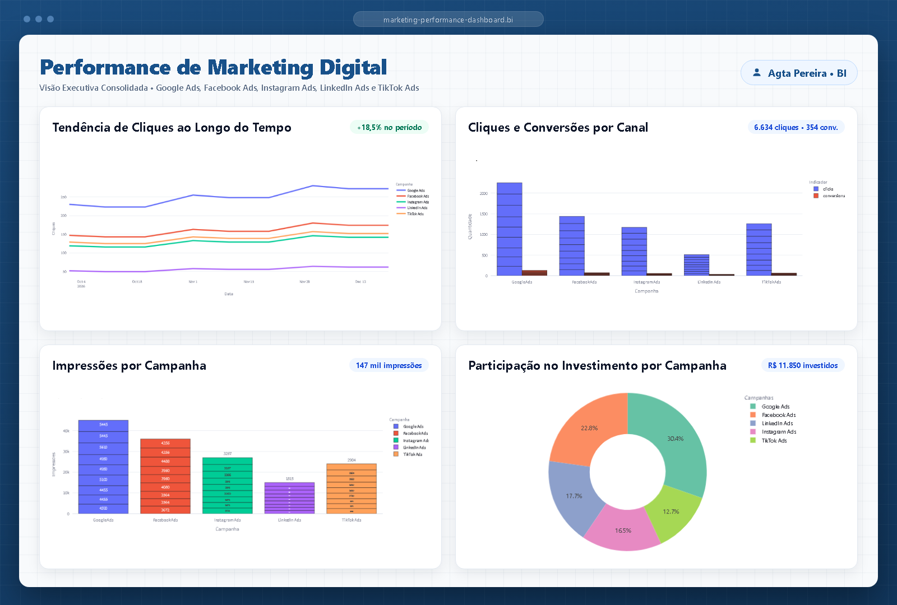
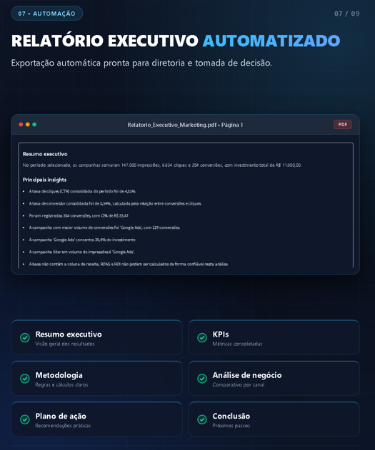

# Dashboard Executivo de Marketing Digital

Projeto desenvolvido para demonstrar técnicas de **Business Intelligence**, **Data Analytics** e **Marketing Analytics** utilizando **Python**.

O dashboard consolida métricas de diferentes canais de marketing em uma única visão executiva, permitindo acompanhar indicadores de desempenho, comparar campanhas e gerar relatórios automatizados.

---

## Resultados Analisados

- **147.000** impressões
- **6.634** cliques
- **354** conversões
- **CTR** de **4,51%**
- **Investimento** de **R$ 11.850**
- **Crescimento de cliques** de **+18,5%**

---

## Principal Insight

> Embora o **Google Ads** tenha registrado o maior volume de conversões (**129**), o **TikTok Ads** apresentou o menor CPA do período (**R$ 23,81**).
>
> Esse resultado demonstra que campanhas com maior volume de conversões não são necessariamente as mais eficientes em custo de aquisição.

---

## Funcionalidades

- Dashboard interativo
- Filtros por período
- Comparação entre canais
- Indicadores executivos (KPIs)
- Tendência de performance
- Distribuição de investimento
- Insights automatizados
- Ranking de campanhas
- Geração automática de relatório executivo em PDF
- Ocultação de valores sensíveis

---

## Tecnologias Utilizadas

- **Python**
- **Pandas**
- **Streamlit**
- **Plotly**
- **ReportLab**

---

## Demonstração

### Dashboard Executivo

### Relatório Executivo Automatizado

---

**Autora:** Agta Pereira • Dados & Consultoria BI
